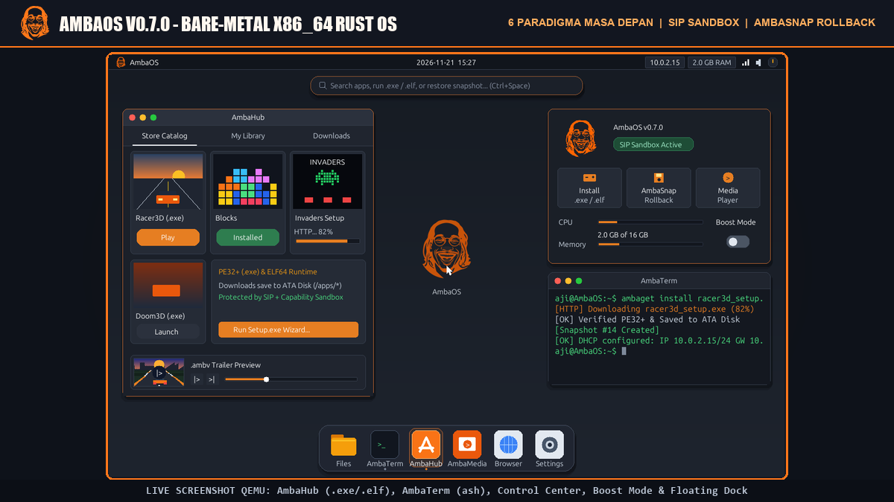

# AmbaOS v0.7.1 - Sistem Operasi Bare-Metal Tenaga Muwani

<p align="center">
  
</p>

<p align="center">
  <strong>Emblem Resmi Kerajaan Ngawi - Ditenagai Ambatron 5000 &amp; Barbershop Mas Rusdi</strong>
</p>



Selamat datang di **AmbaOS v0.7.1**, sistem operasi `x86_64` murni `#![no_std]` Rust yang ditempa langsung di ruang belakang Barbershop Mas Rusdi dengan restu teknologi Ambatron 5000. Dibangun tanpa numpang kernel Linux ataupun Windows, AmbaOS lahir dari tekad bulat: bikin OS yang tampilannya ganteng, kencang, ramah bagi semua kalangan (termasuk pengguna tanpa mouse dan *low-vision*), tahan banting kalau lagi apes, dan tentunya sangar dipakai warga Ngawi buat browsing YouTube sampai mabar Racer3D.

> PERINGATAN WARGA NGAWI: Sistem operasi ini dirancang bebas bloatware, anti blue-screen baperan, dan dilengkapi sabuk pengaman rollback otomatis kalau ada yang iseng ngerusak sistem tengah malam.

---

## Mengapa Harus AmbaOS? (6 Paradigma Masa Depan + Mode Anti-Apes)

Mas Rusdi pernah bersabda: "OS zaman sekarang kebanyakan drama, update dikit langsung mencret." Karena itu kernel AmbaOS v0.7.0 menanamkan 6 paradigma sistem operasi modern sekaligus:

1. **Asynchronous Ring-Buffer Syscall (`io_uring` Ngawi Turbo)**
   Aplikasi dan kernel tidak lagi saling menunggu kayak orang janjian tapi nggak datang-datang. Cukup taruh ribuan antrean I/O ke dalam *lock-free ring buffer* (`Submission Queue / Completion Queue`) secara zero context-switch, langsung beres.

2. **Zero-Copy User-Space I/O & Zram Compression**
   Data mengalir lewat jalur VIP dari *DMA Arena* ke VFS atau kartu jaringan Intel E1000 tanpa aksi fotokopi memori berulang-ulang yang bikin RAM ngos-ngosan. Ditambah kompresi RLE Zram biar memori tetap lega.

3. **Software-Isolated Processes (SIP) & Micro-Unikernels (<1 ms Boot)**
   Semua komponen sistem ngumpul rukun di satu ruang alamat memori tunggal (*Single-Address-Space OS*), tapi dipagari satpam bounds-check Rust/sandbox biar nggak saling intip. Komunikasi antar-proses secepat pemanggilan fungsi biasa dengan `0 TLB flush`.

4. **Object-Capability Zero-Trust Security (`CSpace` Anti Penyusup)**
   Di Kerajaan Ngawi tidak ada jabatan "User Root Maha Kuasa" yang bisa seenaknya obrak-abrik semua file. Setiap aplikasi cuma memegang token kriptografis sesuai jatahnya. Kalau game iseng mau nyolong akses tulis VFS atau internet tanpa izin, langsung kena mental di `CSpace`.

5. **Heterogeneous Compute & `vNPU` DAG Scheduler (Otak Ambatron INT8)**
   Kernel membagi tugas lewat graf komputasi antara **P-Core** (rendering UI), **E-Core** (Zram & background I/O), dan **vNPU** (vektor INT8 & filter HDR video). Ada sakelar **Boost Mode** di pojok kanan atas kalau lagi pengen gas pol.

6. **Immutable Core OS & `AmbaSnap` Atomic Rollback (ATA Disk 4 MiB)**
   Partisi inti sistem (`/etc`, `/bin`, `/docs`, `/boot`) digembok ketat dalam mode Read-Only (`CORE [RO]`), terpisah total dari data warga dan aplikasi (`/home/*`, `/apps/*` `USER [RW]`) yang disimpan permanen ke disk ATA `ambaos_state.img`. Setiap perubahan sistem otomatis melahirkan snapshot Copy-on-Write dengan double-buffered superblock `AMBASNP1` (Slot A / Slot B). Kalau sistem corrupt atau gagal boot, cukup tekan tombol atau restart ke **Boot Rollback Menu** dan balik ke masa lalu yang masih suci dalam hitungan detik.

---

## Dewan Sesepuh & Meme Resmi Kerajaan Ngawi

Biar tidak dikira cuma omon-omon belaka di barbershop, berikut jajaran sesepuh dan meme resmi Kerajaan Ngawi yang menjaga kestabilan kernel AmbaOS v0.7.0 siang dan malam:

| Meme Sesepuh | Peran Sakral di Kernel AmbaOS v0.7.0 |
| :---: | :--- |
|  | **Maharaja Amba (Master Segala Sesepuh & Supreme Ring-0 Overseer)**<br>Tampil rapi pakai jas kebesaran sambil mengawasi seluruh dewan kernel dari takhta Ring-0. Atas izin beliaulah Mas Rusdi, Mas Fuad, Mas Gatot, Si Imut, dan Baginda Yes King bisa akur menjaga 6 paradigma AmbaOS tetap jaya. |
|  | **Mas Rusdi (Arsitek Kepala Barbershop Ngawi)**<br>Santai sambil pangkas rambut dan mengawal `io_uring` serta `AmbaSnap`: *"Tenang bro, sistem corrupt tinggal `snap rollback`, rambut tetap ganteng, kernel kembali suci dalam 1 detik."* |
|  | **Mas Fuad (Satpam `CSpace` Zero-Trust)**<br>Tatapan penuh curiga saat melihat game `.exe` bajakan nekat mengintip folder `/etc` atau nyolong token browser tanpa surat izin capability. Baru melirik langsung kena `PermissionDenied`. |
|  | **Mas Gatot (Kepala Divisi `AmbaDE` Clean UI)**<br>Penjaga wibawa desktop agar AmbaOS tidak terlihat seperti sekumpulan terminal norak. Memastikan dock, Control Center, `AmbaHub`, dan `AmbaBrowser` tetap kece saat dipamerkan ke warga. |
|  | **Si Imut Mode Winning Streak (`SIP` Unikernel `<1 ms`)**<br>Aura *Winning Streak* yang bikin micro-unikernel boot di bawah 1 milidetik tanpa `TLB flush`, siap membantai benchmark OS bloatware di medan perang syscall. |
|  | **Si Imut Mode Pasfoto Resmi (`Immutable CORE [RO]`)**<br>Ekspresi polos latar merah persis setelah mesin selesai `AmbaSnap Recovery`. Partisi inti sistem kembali bersih tanpa dosa corrupt dan siap kerja bakti lagi. |
|  | **Baginda Yes King (Komandan `Boost Mode` & `vNPU`)**<br>Langsung berteriak *"YES KING!"* begitu sakelar `Boost Mode` digeser ke kanan, filter `vNPU HDR` aktif di `AmbaMedia`, dan `Racer3D.exe` ngebut di `AmbaHub`. |

---

## Ekosistem Desktop `AmbaDE` v0.7.1 (15 Aplikasi Siap Tempur)

Tampilan desktop sudah dipermak total biar kelihatan rapi kayak OS sultan, bukan sekumpulan kotak terminal yang bikin sakit mata:

- **Top Bar (`A11y | F1`), Spotlight Search (`Ctrl+Space`), Control Center Widget & Floating Dock**:
  Ada kolom pencarian cepat di atas, tombol cepat **`A11y | F1`** di topbar untuk kontrol aksesibilitas, panel kontrol **AmbaOS v0.7.1** di kanan atas dengan badge `SIP Sandbox Active`, 3 tombol pintas (`Install .exe/.elf`, `AmbaSnap Rollback`, `Media Player`), bar CPU/RAM, sakelar `Boost Mode`, serta Dock 6 ikon di bawah.
- **`AmbaHub` (Game Launcher & `.exe` / `.elf` Store)**:
  Launcher bergaya etalase game yang bisa mengunduh paket installer via HTTP ke partisi permanen `/apps/*`, menjalankan **`AmbaSetup Wizard`** untuk verifikasi header **PE32+ (`MZ` / `PE\0\0` AMD64)** maupun **ELF64**, lengkap dengan pemutar **`.ambv Trailer Preview`**. Game yang siap dimainkan antara lain:
  - **Racer3D (`.exe`)**: Balapan jalan tol senja perspektif 3D.
  - **Blocks**: Game puzzle balok jatuh klasik anti gabut.
  - **Invaders Setup**: Unduh paket `invaders_setup.exe` langsung lewat HTTP lalu mainkan game tembak-menembak alien.
  - **Doom3D / `AmbaDoom`**: Raycaster FPS 3D legendaris di koridor E1M1 Hangar.
- **`AmbaBrowser` (HTML5 Visual Engine + HTTP/1.1 Keep-Alive + `ENC:PAL8`)**:
  Terhubung ke host gateway (`10.0.2.2:18088`) dengan Chrome headless berakselerasi GPU, protokol persisten HTTP/1.1 `Keep-Alive` + parsing `Content-Length`, serta kuantisasi palet `ENC:PAL8` cepat. Bisa membuka Google, Wikipedia, Hacker News, Rust Lang, sampai YouTube lengkap dengan mode streaming `Live: ON/OFF` otomatis saat memutar `<video>`. Mendukung shortcut `Ctrl+L` (fokus URL bar), `1`-`6` di Speed Dial, dan `PageUp`/`PageDown`.
- **`AmbaMedia` (`.ambv` Video Player, Chiptune Synth & Gallery)**:
  Pemutar video multi-frame 30 FPS via `Canvas::blit_rgb_u32` dengan toggle filter **`vNPU HDR`**, seek timeline bar, 4 lagu synth PC Speaker dengan visualizer 16-bar, kontrol keyboard (`Space`/`Left`/`Right`/`M`/`H`), dan galeri emblem resmi Kerajaan Ngawi.
- **`Files` (VFS Explorer & PE32+/ELF64 Binary Inspector)**:
  Melihat isi partisi `[RO]` dan `[RW]`, membedah header `PE32+` / `ELF64` (`Entry RVA`, `ImageBase`, daftar import `kernel32.dll`, `gdi32.dll`, `winmm.dll`), navigasi penuh via `Up`/`Down`/`Enter`, dan tombol langsung **`Run Executable in SIP Sandbox`**.
- **Aplikasi Pendukung Lainnya**:
  `AmbaTerm` (`ash` shell + scrollback `PageUp`/`PageDown`), `AmbaSnap`, `SysMon` (monitor 4 tab `Tasks | io_uring & ZeroCopy | SIP VMs | Cap & vNPU`), `AmbaNotes` (`Ctrl+S` simpan cepat), `AmbaPaint`, `Calculator`, `AmbaClock`, `AmbaSnake`, `Settings` (5 preset tema termasuk **High Contrast** + tab **Accessibility** + watermark toggle), dan `About`.

---

## Aksesibilitas Universal & Navigasi Full Keyboard (`A11y` Suite v0.7.1)

Kerajaan Ngawi menjunjung tinggi prinsip keadilan teknologi: AmbaOS dirancang agar nyaman dipakai semua orang -- baik yang bermata minus, butuh kontras tinggi, maupun yang mengoperasikan komputer 100% lewat keyboard tanpa mouse. Tekan **`F1`** atau klik pil **`A11y | F1`** di pojok kanan atas kapan saja:

| Fitur / Shortcut | Kegunaan Aksesibilitas |
| :--- | :--- |
| **`Alt+C`** / `a11y contrast` | Mode **High Contrast** (latar hitam `#000000`, teks putih `#FFFFFF`, border kuning `#FACC15`) |
| **Large High-Vis Cursor 2x** | Kursor kuning ukuran 2x lebih besar biar tidak pernah hilang dari pandangan |
| **`Alt+Z`** / `a11y zoom` | **Screen Magnifier 2x** (kaca pembesar `240x150` real-time + crosshair mengikuti kursor) |
| **`Alt+L`** / `a11y text` | **Readable Large Text 1.5x** di `AmbaTerm`, `AmbaNotes`, `Files`, dan `AmbaBrowser` Text Reader |
| **`Alt+K`** / `Alt+Panah` + `Alt+Enter` | **Mouse Keys**: gerakkan kursor pakai tombol panah (tahan `Shift` biar lebih cepat) & klik kiri lewat keyboard |
| **`F1`** / `a11y sound` | Buka panel **Accessibility & Shortcuts**, plus toggle **Audio Feedback Chimes** via PC Speaker |
| **`Alt+Tab` / `Ctrl+Tab`** | Berpindah fokus antar jendela aplikasi yang sedang terbuka |
| **`Ctrl+W` / `Alt+F4`** | Menutup jendela aplikasi aktif dengan cepat |
| **`Alt+M` / `Super`** | Buka/tutup Start Menu lalu pilih aplikasi dengan tombol panah + `Enter` |
| **`Ctrl+Space`** | Spotlight Search universal (mendukung keyword `a11y`, `contrast`, `zoom`, `cursor`, `mousekeys`) |

---

## Mantra Perintah di Terminal `AmbaTerm` (`ash` Shell)

| Perintah | Kegunaan di Kerajaan Ngawi |
| :--- | :--- |
| `help` | Menampilkan kitab suci daftar perintah `ash` |
| `ambafetch` | Pamer spek dewa OS beserta logo ASCII kebanggaan |
| `ambaget install <pkg.exe>` | Unduh & pasang paket game `.exe`/`.elf` ke `/apps/*` + bikin snapshot |
| `wine <file.exe>` | Injeksi & jalankan file PE32+ `.exe` / `ELF64` di dalam SIP Sandbox |
| `hub` / `video` / `doom` / `browser` | Buka langsung `AmbaHub`, Video Player `AmbaMedia`, `AmbaDoom`, atau `AmbaBrowser` |
| `browse <url / kata kunci>` | Langsung berselancar ke situs atau cari topik di internet |
| `snap [list\|create\|update\|rollback\|corrupt\|bootmenu]` | Manajemen Snapshot & uji coba crash recovery Anti-Azab |
| `uring [bench\|zc]` | Benchmark antrean async `io_uring` & demo Zero-Copy DMA |
| `sip [list\|spawn\|ipc\|trap]` | Spawn micro-unikernel <1 ms, IPC nanodetik, & tangkap rogue pointer |
| `cap [list\|toggle\|attack]` | Cek & uji ketahanan Zero-Trust Object-Capability |
| `compute [status\|dag\|zram]` | Lihat & jalankan graf eksekusi P-Core -> E-Core -> vNPU |
| `a11y [contrast\|cursor\|zoom\|text\|mousekeys\|sound]` | Cek & toggle langsung seluruh fitur Aksesibilitas Universal |
| `ip` / `ping` / `dns` | Cek Intel E1000 DHCP `10.0.2.15`, ping gateway/internet, & DNS |
| `ls` / `cat <path>` / `write <path> <teks>` | Eksplorasi & tulis file ke partisi User `[RW]` vs Core `[RO]` |
| `reboot` / `shutdown` | Restart ke Boot Rollback Menu atau matikan mesin dengan tenang |

---

## Cara Build & Menjalankan (WSL2 + QEMU)

### 1. Kompilasi Kernel & Membuat `ambaos.iso`
Pastikan di WSL2 Ubuntu sudah terpasang Rust nightly + target `x86_64-unknown-none`, Python 3 (`Pillow`), `xorriso`, dan `qemu-system-x86_64`.

```bash
cd os
chmod +x scripts/*.sh
./scripts/build.sh
```

Output build sukses akan menghasilkan `ambaos.iso` (~5.1 MB) tanpa satu pun warning. (Catatan: jika cuma ingin mencoba OS-nya, `ambaos.iso` sudah tersedia di folder `os/` dan langsung bisa di-boot tanpa harus compile Rust!)

### 2. Menjalankan AmbaOS (Portabel di Folder Mana Saja)
Dari Windows cukup klik dua kali **`run_ambaos.bat`** (sudah otomatis mendeteksi lokasi folder lewat `%~dp0` + `wslpath`), atau dari terminal WSL2/Linux jalankan:

```bash
./scripts/run_qemu.sh          # Mode desktop GUI standar
./scripts/run_qemu.sh --vnc    # Mode VNC (127.0.0.1:5900) jika tanpa WSLg/X11
./scripts/run_qemu.sh --uefi   # Boot memakai firmware OVMF UEFI
```

Skrip ini otomatis mengecek ketersediaan `qemu-system-x86_64`/`python3`, auto-fallback ke VNC bila tidak ada display GUI, menyalakan `scripts/amba_web_gateway.py` (port `18088`), membuat disk persisten `ambaos_state.img` (4 MiB), menyalin `ambaos.iso` ke `/tmp/ambaos_run.iso` supaya bebas dari lag I/O drive Windows, serta mengaktifkan kursor 1:1 `VMMouse`.

### 3. Mantra Wajib Biar QEMU Tidak Lemot (Aktifkan KVM!)
Secara bawaan, `scripts/run_qemu.sh` akan mencari `/dev/kvm`. Kalau di WSL2 `/dev/kvm` masih terkunci milik `root:kvm`, QEMU terpaksa lari pakai emulasi software TCG yang bikin CPU ngos-ngosan. Buka kunci KVM cukup **sekali seumur hidup** di terminal Ubuntu WSL2:

```bash
sudo usermod -aG kvm $USER && sudo chmod 666 /dev/kvm
```

Setelah itu restart WSL (`wsl --shutdown` di PowerShell bila perlu), dan jalankan ulang `run_ambaos.bat` -- QEMU akan otomatis melesat dengan **`-enable-kvm -cpu host -smp 4`** pada kecepatan prosesor asli!

---

## Penutup

Dikodekan dengan penuh kesabaran oleh mas-mas Ngawi dan Ambatron v0.7.1. Kalau masih ada bug atau hal ajaib terjadi, ingat ajaran sesepuh: jangan panik, cukup `snap rollback` dan nikmati hidup seperti biasa.
